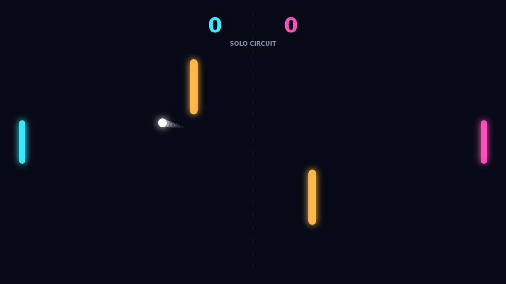

# Bend the rally

Carom is a neon top-down paddle duel where every return is a choice. Meet the ball square for a clean drive, or move through contact to load it with spin and watch its route curl across the dark field.

The opening serve points toward the receiving player, then the pace builds with each paddle hit. Two amber obstacles split the center into bank-shot lanes, turning a simple rally into a quick geometry puzzle.

In Solo, a reactive opponent tracks incoming shots while you shape the left paddle's returns. Local Versus puts both paddles on one keyboard for a direct duel. The first player to 11 wins—but only with a two-point lead.

At match point, a last-second curve or obstacle carom can turn defense into the winning line. The controls stay spare; the angles keep changing.
